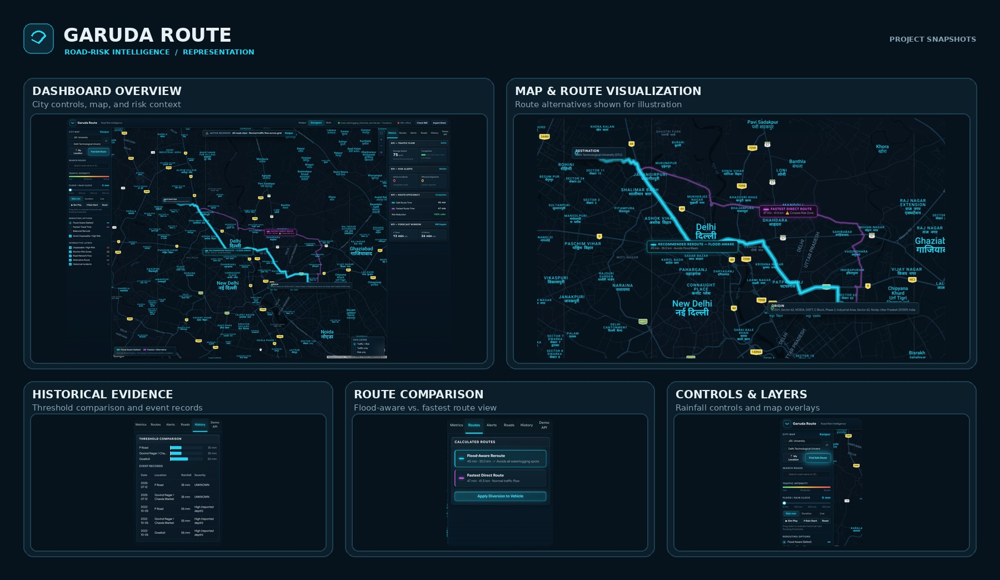
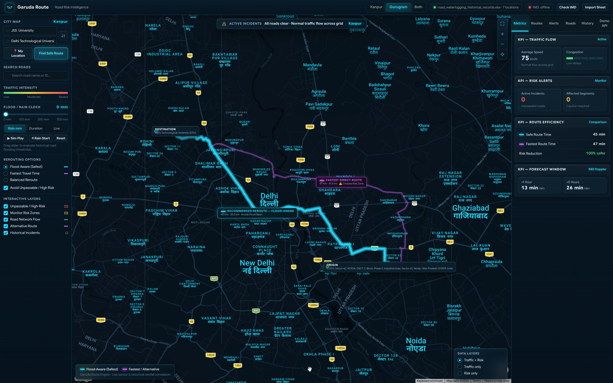
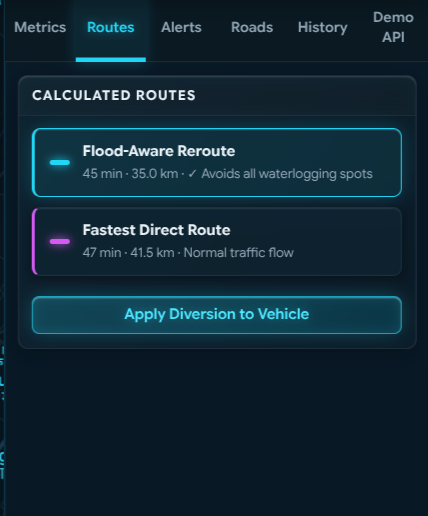
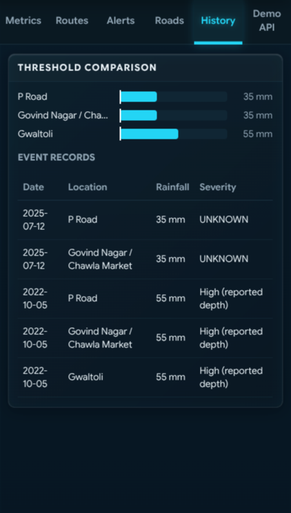
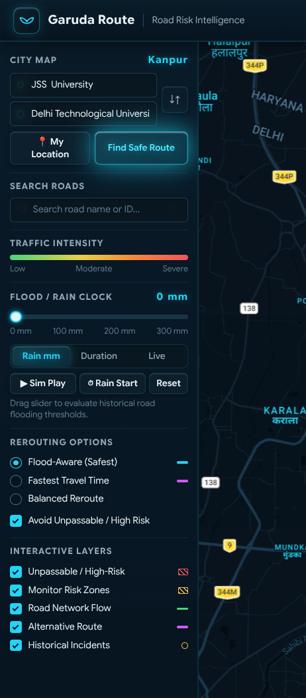
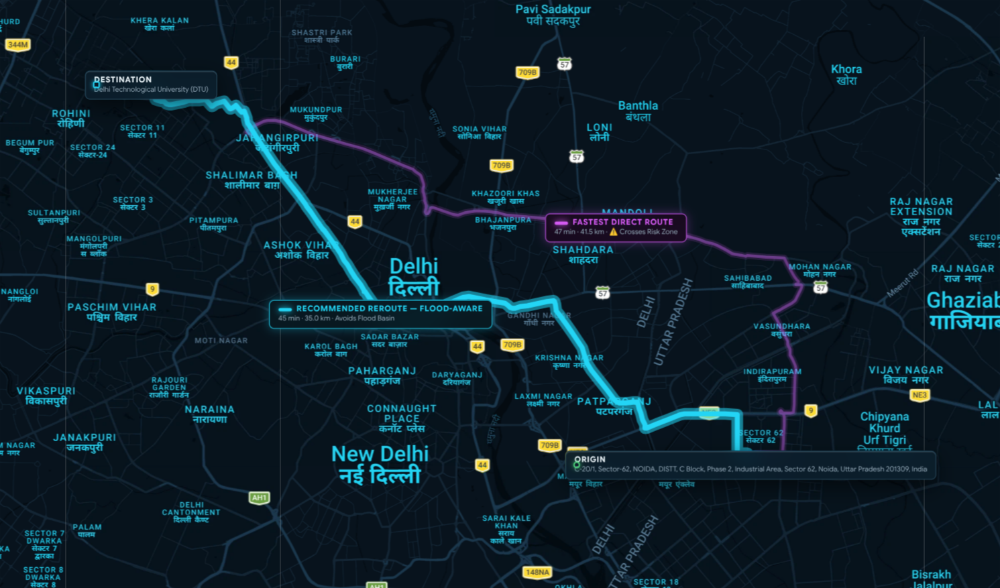

# Garuda Route

**Road waterlogging awareness, historical evidence, and route comparison for rainfall-prone journeys.**

Garuda Route is a prototype for exploring documented waterlogging locations in Kanpur and Gurugram, comparing those records with a user-controlled rainfall timeline, and examining route options. It also contains a Python risk-engine module for tracking rainfall observations and comparing continuous rainfall duration with configured historical indicators.

> **Prototype and data notice:** This is not a certified flood-prediction or emergency-navigation system. Historical reports are incomplete, some rainfall values describe a city or district rather than a specific road, and the bundled road-threshold file contains illustrative records. A map or route marked lower-risk is not a guarantee that a road is safe.

## Contents

- [Current status](#current-status)
- [Representation](#representation)
- [What it does](#what-it-does)
- [How the parts fit together](#how-the-parts-fit-together)
- [YouTube demo](#youtube-demo)
- [Quick start](#quick-start)
- [Configuration](#configuration)
- [Testing](#testing)
- [Repository layout](#repository-layout)
- [Data and risk semantics](#data-and-risk-semantics)
- [Limitations and safety](#limitations-and-safety)
- [Project KPIs](#project-kpis)
- [Contributing](#contributing)


## Representation

A visual overview of Garuda Route's dashboard, map-based route visualization, historical waterlogging evidence, and interactive controls.

<p align="center">
  
</p>

<details>
  <summary>View individual screenshots</summary>

  <p align="center">
    
  </p>
  <p align="center">
    
  </p>
  <p align="center">
    
    
  </p>
  <p align="center">
    
  </p>
</details>

*Screenshots illustrate the interface. Live-weather availability and road-risk assessments depend on authorized data access, configuration, and supporting evidence.*


> **Demo video:** [YouTube demo](https://youtube.com/shorts/L_Qpsq48dAU?si=PIr9pBsefdJdHPjI)

## Current status

The checked-in `main` baseline is a development prototype. The historical dashboard can be explored locally; Google-based route comparison depends on its provider configuration, the separate M3 risk API requires its own configured process, and the intended live-weather workflow requires official IMD permission and issued credentials before API access can be activated.

| Component | Current behaviour | Requirements / caveat |
|---|---|---|
| Historical evidence dashboard | Loads the bundled historical records for Kanpur and Gurugram; supports city selection, location details, alerts, and history views | The bundled JSON currently contains 10 event records across 7 locations; public reports may be incomplete |
| Rainfall clock | Lets you explore reported rainfall amounts or duration and see how the dashboard’s reference classifications change | This is an interactive historical comparison/simulation, not a sensor feed |
| Map | Tries Google Maps first and falls back to OpenStreetMap if Google Maps is unavailable | OpenStreetMap fallback provides a map, but Google-specific geocoding and route comparison are unavailable without a working Google Maps key/API setup |
| Route comparison | Requests route options through Google Maps and evaluates them against locations flagged by the dashboard’s historical comparison | Not guaranteed to avoid actual flooding; Google Maps routing must be configured |
| IMD district warnings/rainfall | Required integration for the intended live-weather workflow; same-origin Node proxy routes are implemented | Live access requires official IMD permission, issued credentials, and the authentication format approved for the project. District values are not road-level measurements |
| Python M3 risk engine | Tracks continuous rainfall observations, checks freshness, and classifies configured roads against configured thresholds | Roads need explicit road-to-location mappings and evidence-supported thresholds for meaningful real-world use |
| Risk API panel | Frontend can query a separate risk service through a Node proxy | The Node server does not start that separate service; the upstream service must be running and configured independently |

## What it does

- **Explore historical reports.** Review waterlogging locations and their source links, event dates, reported rainfall context, and known evidence gaps.
- **Compare a rainfall reference.** Use the rainfall clock to explore how the front-end’s reference classification responds to recorded rainfall figures.
- **View locations on a map.** Select Kanpur, Gurugram, or both and inspect locations with available coordinates or approximate geocoding.
- **Review alerts and road details.** Filter locations by the dashboard’s current reference classification and inspect their supporting notes.
- **Compare route options.** When Google Maps routing is configured, compare candidate routes against the locations currently flagged by the historical comparison.
- **Integrate official IMD district weather.** The project requires IMD data for its intended live-weather workflow. API access must first be formally authorized by IMD and the issued credentials configured on the backend; credentials are not bundled with the repository.
- **Exercise the M3 risk engine.** Run the Python simulation and tests for observation ingestion, duration tracking, freshness, mapping, and threshold comparison.

## How the parts fit together

```text
Historical source records ──> Browser dashboard ──> Map / alerts / history
                                      │
                                      ├──> Optional Google Maps route comparison
                                      │
                                      ├──> Node backend ──> IMD district endpoints (official permission + credentials required)
                                      │
                                      └──> Node risk proxy ──> Separate risk API service

Rainfall observations ──> Python M3 risk engine ──> Road risk assessment
```

The historical dashboard and M3 risk engine have related goals, but they are **not interchangeable data sources**:

- The browser’s historical comparison uses event values from the bundled historical dataset. Its current reference logic marks `MONITOR` at 75% and `HIGH_RISK` at 100% of the reported reference value; these are UI heuristics, not validated road-specific flood thresholds.
- The M3 engine evaluates configured road records against an explicit historical threshold and tracks observations over time. It requires correct road-to-observation mappings. An unmapped road, stale observation, or missing threshold must not be represented as confirmed safe.
- IMD district weather context is shown separately because district rainfall is not a measurement taken on every road.

## YouTube demo

**Demo walkthrough:** _YouTube link pending._ Replace this note with the published or unlisted YouTube URL once the recording is uploaded. Do not link a local video file or an unlisted video that viewers are not permitted to access.

Example format:

```text
https://www.youtube.com/watch?v=YOUR_VIDEO_ID
```

When the URL is available, this section can be changed to a clickable link or a linked video thumbnail.

## Quick start

### Prerequisites

- Node.js 18 or newer for the local web server. Node.js 22 or newer is recommended for the current JavaScript test command.
- Python 3 for the M3 tests and simulation.
- A modern browser.
- Optional: a restricted Google Maps browser key for Google Maps and route comparison.
- **IMD live-data access:** official IMD permission and issued API credentials are required before the live-weather integration can be activated. These are not included in the repository.

### 1. Clone the repository

```bash
git clone https://github.com/SG4067/garuda-route.git
cd garuda-route
```

### 2. Install the requirements

#For Windows
```bash
python -m venv .venv
.\.venv\Scripts\activate.bat
pip install -r .\backend\requirements.txt
copy .\backend\.env.example .\backend\.env
```
#For Linux & MacOS
```bash
python -m venv venv
source venv/bin/activate
pip install -r backend/requirements.txt
cp backend/.env.example backend/.env
```

### 3. Start the web app

The Node server uses built-in Node modules; no root-level `npm install` is required for this server.

```bash
node backend/server.js
```

Open <http://127.0.0.1:3000> in any browser.

Without a Google Maps browser key, the app attempts to use OpenStreetMap. The historical dashboard can still be explored, but Google-specific route comparison and geocoding will not be available.

### 4. Run the M3 simulation (optional)

From the repository root:

```bash
python risk-engine/simulation.py
```

This produces simulated observations to demonstrate the risk-engine lifecycle. It is not a live weather feed and does not persist the observations as production telemetry.

## Configuration

The Node server reads configuration from environment variables. The checked-in `backend/server.js` does not automatically load a `.env` file, so export variables in the shell before starting the server, or use a local launcher that loads them securely.

### Google Maps

Set a browser key( Geocoding API | Geolocation API | Maps JavaScript API | Routes API | Weather API) if you want Google Maps, geocoding, and Google-based route comparison:

```bash
export GOOGLE_MAPS_BROWSER_KEY="your-restricted-browser-key"
node backend/server.js
```

The key is delivered to the browser through `/config.js`, so treat it as a **public browser key**, not a secret. Restrict it by allowed HTTP referrers and enable only the Google APIs required by this application. Never commit a real key to the repository.

### IMD API access (official permission required)

IMD data is a required integration for the intended live-weather workflow; it is not an optional product feature. **Before making API requests, obtain official IMD permission and the credentials/authentication instructions issued for this project.** This repository does not include credentials, and the dashboard cannot show live IMD data until authorized access has been granted and the backend is configured.

Once access is granted, set the credential and authentication format issued by IMD. The server defaults to an `Authorization` header with the `Bearer` prefix only if that matches the issued instructions:

```bash
export IMD_API_KEY="your-issued-credential"
export IMD_API_KEY_HEADER="Authorization"
export IMD_API_KEY_PREFIX="Bearer"
export IMD_API_KEY_MODE="header"
node backend/server.js
```

Only use the default header/prefix if they match your issued credential. If your credential is issued for query-string authentication, configure `IMD_API_KEY_MODE=query` and `IMD_API_KEY_QUERY_PARAMETER` according to the provider’s instructions. Do not put the IMD credential in frontend JavaScript or documentation.

The app uses these same-origin backend routes:

- `GET /api/imd/warnings`
- `GET /api/imd/rainfall`

When authorized credentials are missing, misconfigured, or rejected, the dashboard reports the feed as unavailable. Historical records remain available as a separate source; they must not be presented as live IMD observations. Never attempt to bypass the official permission process.

### Separate risk API (optional)

The Node backend proxies dashboard risk requests to an upstream service. The upstream base URL defaults to `http://127.0.0.1:8000` and can be changed with:

```bash
export GARUDAROUTE_RISK_API_BASE_URL="http://127.0.0.1:8000"
node backend/server.js
```

The browser-facing proxy routes are:

- `GET /api/risk/roads`
- `GET /api/risk/roads/{road_id}/risk`

The upstream service is expected to implement the M3 API contract described in [`API_CONTRACT.md`](API_CONTRACT.md). Starting `backend/server.js` alone does not start this upstream service. Check that the upstream process is running before expecting the risk panel to populate.

### Windows PowerShell note

Set variables before starting Node, for example:

```powershell
$env:GOOGLE_MAPS_BROWSER_KEY = "your-restricted-browser-key"
$env:IMD_API_KEY = "your-issued-credential"
$env:IMD_API_KEY_HEADER = "Authorization"
$env:IMD_API_KEY_PREFIX = "Bearer"
$env:IMD_API_KEY_MODE = "header"
node backend/server.js
```

Configure the Google Maps variables only if using Google Maps. Configure the IMD variables only after official IMD permission and credentials have been obtained; they are a prerequisite for activating the required live-weather integration.

## Testing

Run these from the repository root.

### Frontend routing and geometry logic

```bash
node --test tests/routing-logic.test.js
```

### Python M3 risk engine

```bash
python -m unittest discover -s risk-engine/tests -v
```

### Backend JavaScript syntax

```bash
node --check backend/server.js
```

The tests cover routing-score selection and geometry helpers, alongside risk-engine behaviour such as rainfall tracking, threshold comparisons, data freshness, and error handling. Passing unit tests does not by itself verify live provider credentials, map tile loading, browser geolocation, or a separately running upstream risk API; verify those integrations in the browser and local environment as well.

## Repository layout

```text
.
├── backend/
│   ├── server.js                 # Static frontend server and provider/risk proxies
│   └── .env.example              # Example settings for the API environment where applicable
├── data/
│   ├── roads.json                # Illustrative road-threshold fixture; not verified production data
│   ├── README.md                 # Dataset handling and provenance notes
│   └── raw/                      # Original research workbook(s), when included
├── frontend/
│   ├── index.html                # Browser dashboard
│   ├── risk-utils.js              # Shared route geometry/scoring helpers
│   └── data/
│       └── road-waterlogging-records.json  # Bundled historical evidence
├── risk-engine/
│   ├── engine/                   # Risk service, comparator, orchestration
│   ├── models/                   # Rainfall, road, and risk models
│   ├── tracker/                  # Continuous rainfall tracking
│   ├── tests/                    # Python unit tests
│   ├── simulation.py             # Local simulated lifecycle
│   └── README.md                 # M3 module details
├── tests/
│   └── routing-logic.test.js     # JavaScript geometry/scoring tests
├── API_CONTRACT.md               # Backend-facing risk API contract
├── ARCHITECTURE.md               # High-level architecture
├── DATA_SCHEMA.md                # Data fields and semantics
└── PROJECT_SPEC.md               # Project scope and non-goals
```

## Data and risk semantics

### Historical evidence is not a live sensor reading

The browser dataset contains 10 historical event records across 7 locations. A record may provide a city/district rainfall figure, an event window, or qualitative impact rather than a precise measurement at the named road. Open the source links and read each record’s scope and notes before drawing conclusions.

### Unknown does not mean zero or safe

- Missing rainfall/duration values remain unknown; do not silently replace them with `0`.
- An event mentioning a locality does not prove the exact coordinates or road segment unless the source supports that association.
- No match in the collected reports is not proof that a location never floods.
- A road without an explicit observation-location mapping is `UNKNOWN` / `UNMAPPED` in the M3 service.
- Stale or absent observations are data-quality states, not evidence that rain stopped.
- The example entries in `data/roads.json` (`DEL-001`, `DEL-002`) are illustrative fixtures. Do not use their thresholds to generate real traveller safety claims.

### Interpreting the M3 engine

The M3 risk engine uses a configurable historical threshold. Its default monitor ratio is 0.70 of the configured threshold; a ratio comparison is an empirical warning heuristic, not a calibrated probability of flooding. The browser’s historical exploration uses its own reference levels. Do not mix the two outputs or present either as a validated road-level prediction without an evidence-supported dataset and validation method.

## Limitations and safety

- The current historical dataset is a small research collection, not a complete official inventory of waterlogging incidents.
- Weather reports and rainfall totals may be city-, district-, or station-level, not road-level.
- The prototype does not model drainage capacity, surface runoff, elevation, river levels, or hydraulic flood propagation.
- A route comparison can flag locations known to the dashboard; it cannot guarantee that a route is dry or safe.
- Live IMD access is a required integration objective, but its use is gated by official IMD permission and issued credentials. Until access is approved and configured (or during outages), the feed must be displayed as unavailable, not normal.
- The upstream M3 API must be configured and running separately for the API panel to return assessments.
- Do not use the prototype as the sole basis for emergency response, traffic control, or travel-safety decisions.

## Project KPIs

These are **recommended evaluation metrics**, not claims that the current dashboard already measures or displays them:

| KPI | Suggested definition | Why it matters |
|---|---|---|
| Evidence coverage | Share of target locations with reviewed source evidence, usable coordinates, and documented limitations | Shows how much of the pilot area is supported by evidence |
| Mapping coverage | Share of configured roads with verified geometry and an explicit observation-location mapping | Prevents unsupported road-level claims |
| Observation freshness | Share of risk assessments based on observations within the configured freshness window | Indicates whether current assessments are time-relevant |
| Route calculation success | Successful route requests divided by valid route requests | Measures routing integration reliability |
| Risk-assessment latency | Time from risk request to returned assessment, ideally including p50/p95 | Helps assess responsiveness |
| Risk classification quality | Precision/recall against independently reviewed historical events, where the labels and evaluation method are defensible | Measures usefulness without inventing accuracy claims |

Do not publish numeric KPI results until the measurement method, sample period, and supporting logs or evaluation dataset are available.

## Contributing

1. Create a feature branch from `main`.
2. Make one focused change at a time.
3. Run the relevant JavaScript and Python tests.
4. Check `git diff --check` before committing.
5. Test browser-facing changes in the actual running app; do not rely only on a code summary.
6. Keep credentials out of source control and preserve source links and uncertainty notes when changing the historical dataset.

## Related documentation

- [`PROJECT_SPEC.md`](PROJECT_SPEC.md) — problem, scope, and non-goals
- [`ARCHITECTURE.md`](ARCHITECTURE.md) — system architecture
- [`API_CONTRACT.md`](API_CONTRACT.md) — risk API fields and status semantics
- [`DATA_SCHEMA.md`](DATA_SCHEMA.md) — field definitions and data rules
- [`risk-engine/README.md`](risk-engine/README.md) — M3 technical documentation

## Disclaimer

Garuda Route provides exploratory, empirical waterlogging indicators. It does not guarantee that flooding will occur or that any alternative route is safe. Always follow official warnings, road closures, and local emergency guidance.
